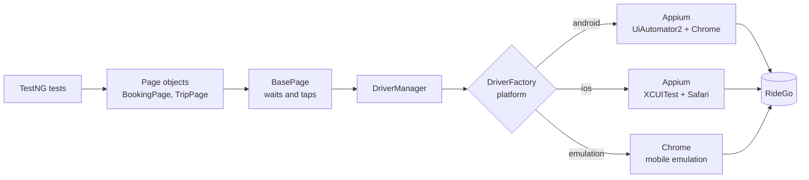

<div align="center">

# 📱 Appium + TestNG Mobile Framework

**Mobile web tests for RideGo ride-hailing on Android, iOS or phone emulation**

    

[](https://github.com/skamirullah/practiceqa-appium-testng-mobile/actions/workflows/ci.yml)  

[What it tests](#-what-it-tests) · [Quick start](#-quick-start) · [How it is built](#-how-it-is-built) · [Structure](#-project-structure) · [Reports](#-reports-and-debugging)

</div>

---

## 👋 Overview

A mobile automation framework with Appium and TestNG. It books rides in a phone browser, follows the trip as it progresses, and checks fares, promo codes and cancellation fees. The same tests run on Android, on iOS, or in phone emulation with no device at all.

|  |  |
|---|---|
| **App under test** | [RideGo](https://www.practiceqaautomation.com/apps/ride), a ride-hailing app with fares, promo codes and live trip status |
| **Kind of testing** | Mobile web |
| **Tests** | 9 tests |
| **Runs in** | Chrome on Android, Safari on iOS, or Chrome phone emulation |

### Highlights

- **One test suite, three platforms.** A single setting switches between Android, iOS and emulation.
- **Runs without a device.** Emulation mode needs no Appium server, so the suite works on any laptop and in CI.
- **Waits for the trip.** Ride status changes on a timer; tests wait for each status instead of sleeping.
- **Calculated fares.** The promo discount is worked out from the fare on screen.

## 🎯 What it tests

| Area | What is checked |
|---|---|
| Route | Fares appear only after pickup and drop are chosen; distance is shown |
| Fares | A bigger vehicle costs more for the same route |
| Promo codes | Half off up to the maximum; an unknown code is rejected |
| Booking | Driver assigned, start OTP, on trip, completed, rating and tip, total paid |
| Validation | A route and a ride type are required |
| Cancellation | Free before the driver arrives, a fee after |

## 🚀 Quick start

**You need:** Java 17+ and Maven 3.9+. For real devices: Node.js, Appium 2 and the Android SDK or Xcode.

```bash
git clone https://github.com/skamirullah/practiceqa-appium-testng-mobile.git
cd practiceqa-appium-testng-mobile
mvn test                     # phone emulation, nothing else to install
```

| Command | What it does |
|---|---|
| `mvn test` | Run in Chrome phone emulation (Pixel 7) |
| `mvn test -Dplatform=android` | Run in Chrome on an Android device or emulator |
| `mvn test -Dplatform=ios -Ddevice.name="iPhone 15"` | Run in Safari on an iPhone or simulator |
| `mvn test -Dsuite=testng-smoke.xml` | Run only the smoke tests |
| `mvn test -Dheadless=false` | Watch the emulated phone |
| `mvn allure:serve` | Open the Allure report |

<details>
<summary><b>Setting up a real Android device or emulator</b></summary>

```bash
npm install -g appium
appium driver install uiautomator2
appium --allow-insecure=chromedriver_autodownload     # leave this running

adb devices                                           # your device or emulator should be listed
mvn test -Dplatform=android
```

For iOS, install the XCUITest driver (`appium driver install xcuitest`) and run with `-Dplatform=ios`.
</details>

> **Tested so far:** the suite passes in phone emulation. The Android and iOS configurations follow Appium's documented options but have not yet been run on a device from this repo.

## 🧱 How it is built



- **Everything is a `WebDriver`.** `AndroidDriver`, `IOSDriver` and `ChromeDriver` share that interface, so page objects do not know which platform they run on.
- **Factory per platform.** `DriverFactory` is the only class with Appium options and capabilities.
- **Typed Appium options.** `UiAutomator2Options` and `XCUITestOptions` instead of raw capability strings.
- **Selenium pinned with its BOM.** The Appium client accepts a range of Selenium versions; the BOM keeps every module on one.
- **Longer waits where the app is timed.** Trip status uses its own timeout, sized for a slow device.

## 📁 Project structure

```text
src
├── main/java/com/practiceqa/ridego
│   ├── config/Config.java          # settings from -D flags, env vars, then config.properties
│   ├── driver/                     # DriverFactory (android, ios, emulation), DriverManager
│   ├── pages/                      # BasePage, BookingPage, TripPage
│   └── data/Trip.java              # places and promo rules
└── test
    ├── java/com/practiceqa/ridego
    │   ├── base/BaseTest.java      # session per test
    │   ├── listeners/TestListener.java   # screenshot on failure
    │   └── tests/                  # FareTests, BookingTests
    └── resources/config.properties
testng.xml                          # full regression
testng-smoke.xml                    # smoke group only
```

## ⚙️ Configuration

Defaults live in `src/test/resources/config.properties`. Override any of them on the command line (`-Dplatform=android`) or with an environment variable (`PLATFORM=android`); nothing needs editing to change environment.

| Setting | Default | What it does |
|---|---|---|
| `platform` | `emulation` | `android`, `ios` or `emulation`. |
| `appium.url` | `http://127.0.0.1:4723` | Appium server, for `android` and `ios`. |
| `device.name` | `Pixel 7` | Device or simulator name. |
| `device.udid` | empty | A specific device. Empty uses the only one connected. |
| `platform.version` | empty | A specific OS version. Empty accepts any. |
| `emulation.device` | `Pixel 7` | Phone that Chrome imitates in emulation mode. |
| `timeout` | `15` | Seconds to wait for an element before failing. |

## 📊 Reports and debugging

- **Allure**: run `mvn allure:serve` after a test run for a report with steps, timings and attachments.
- **Failures** attach a screenshot of the phone screen and the page URL.
- **Surefire**: `target/surefire-reports/` holds the TestNG HTML and XML results.

## 🔁 Continuous integration

[GitHub Actions](.github/workflows/ci.yml) runs the suite in phone emulation on every push and pull request. A second job, started by hand, boots an Android emulator, starts Appium and runs the smoke suite on it.

## 🧪 About the app under test

RideGo takes a pickup and a drop, prices five ride types by distance and time, accepts a promo code, and then moves the ride through its stages on a timer: driver assigned, arrived, on trip, completed.

[PracticeQAAutomation](https://www.practiceqaautomation.com) is a free practice site for QA engineers, with realistic apps to automate with Selenium, Playwright and Cypress. All data in these tests is fictional.

## 👤 Author

**Sk Amir Ullah** · Technical Lead, SDET and Test Automation

[Portfolio](https://skamirullah.com) · [LinkedIn](https://linkedin.com/in/skamirullah) · [GitHub](https://github.com/skamirullah) · [PracticeQAAutomation](https://www.practiceqaautomation.com)

## 📄 License

[MIT](LICENSE)
